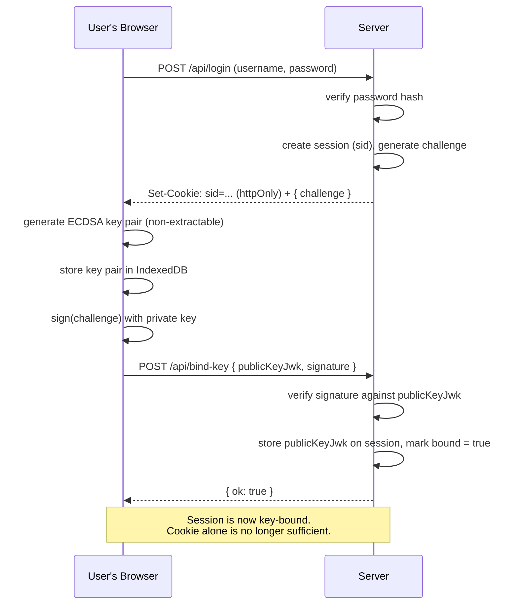
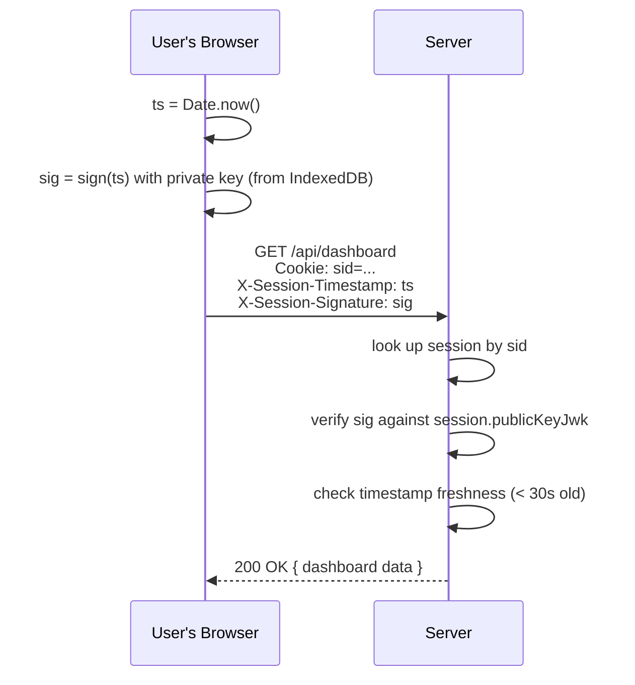
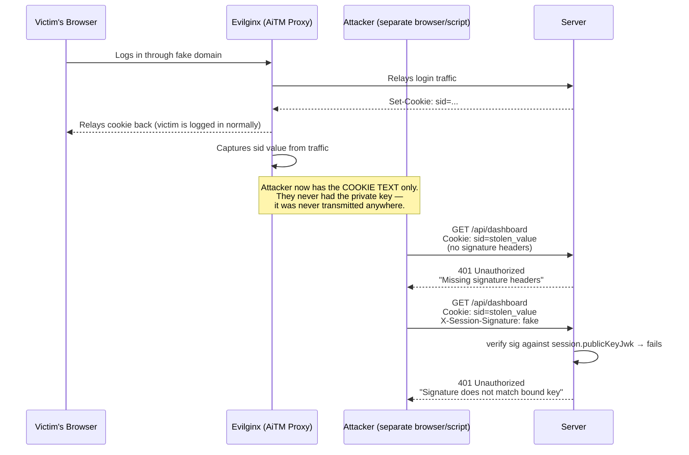

# Architecture

This document explains the components, data flow, and the exact point
where a stolen session cookie gets rejected.

## Components

```
┌──────────────────────────────┐        ┌──────────────────────────────┐
│          BROWSER             │        │            SERVER            │
│                               │        │                               │
│  ┌─────────────────────────┐ │        │  ┌─────────────────────────┐ │
│  │  index.html / dashboard │ │        │  │        server.js         │ │
│  │  (UI, fetch() calls)    │ │        │  │  Express routes +        │ │
│  └───────────┬─────────────┘ │        │  │  signature middleware    │ │
│              │                │        │  └───────────┬─────────────┘ │
│  ┌───────────▼─────────────┐ │  HTTPS │              │               │
│  │  crypto-session.js      │◄┼────────┼──────────────►│               │
│  │  (Web Crypto + IndexedDB)│ │        │  ┌───────────▼─────────────┐ │
│  └───────────┬─────────────┘ │        │  │   sessions Map (demo)    │ │
│              │                │        │  │ sid -> {publicKeyJwk,   │ │
│  ┌───────────▼─────────────┐ │        │  │         bound, user}    │ │
│  │   IndexedDB              │ │        │  └─────────────────────────┘ │
│  │   private key (never     │ │        │                               │
│  │   leaves this box)       │ │        │                               │
│  └─────────────────────────┘ │        │                               │
└──────────────────────────────┘        └──────────────────────────────┘
```

- **Browser**: runs the UI and `crypto-session.js`, which generates a
  non-extractable ECDSA (P-256) key pair via the Web Crypto API and
  stores it in IndexedDB. The private key never leaves this box, not
  even to the server.
- **Server**: Express app (`server.js`) that issues session cookies,
  binds public keys to sessions, and verifies a fresh signature on
  every protected request.

## Flow 1 — Normal login and key binding



## Flow 2 — Legitimate use of a protected route



## Flow 3 — Stolen cookie replay (the attack this project stops)



## Why this works

The server never trusts the cookie alone. It trusts a **signature**
produced by a private key that:

1. Was generated inside one specific browser via `crypto.subtle.generateKey()`
   with `extractable: false`.
2. Is stored in that browser's IndexedDB and never serialized or sent
   over the network, ever.
3. Can only produce valid signatures from inside that same browser.

A copy of the cookie text — exactly what a network-based AiTM proxy
like Evilginx can capture — carries no proof of possessing that key,
so it is rejected by the `requireBoundSession` middleware in `server.js`.

## Known limitations (see README for full discussion)

- Does **not** stop a *live*, actively-relayed AiTM session (the
  victim's browser is still the one signing requests in that case).
- Does **not** protect against device-level malware with the same
  privilege as the browser — only hardware-backed keys (WebAuthn
  platform authenticators / TPM / Secure Enclave) close that gap.
- Every protected route must use the `requireBoundSession` middleware,
  or it bypasses the whole scheme.
